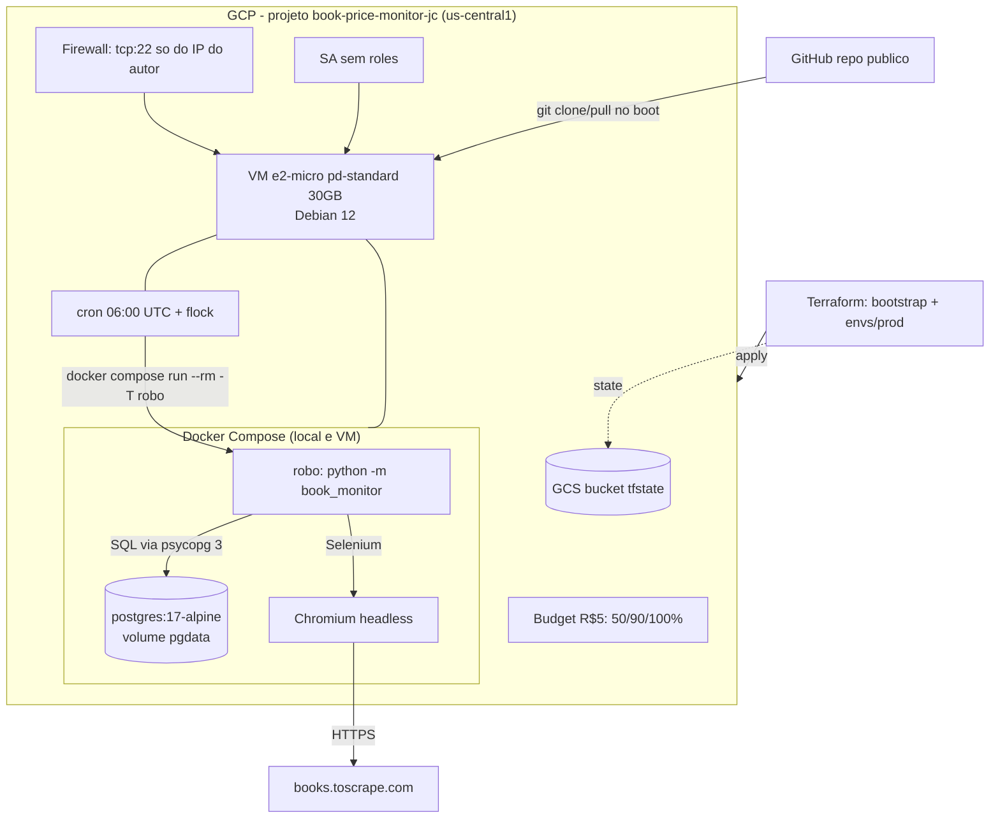

# Book Price Monitor Design

**Spec**: `.specs/features/book-price-monitor/spec.md`
**Status**: aprovado (2026-10-24)

Pesquisa feita em 2026-10-23: Context7 (provider Google v7.46.1, Terraform, Selenium, psycopg 3), docs oficiais do Free Tier e Docker Hub (tags `python:3.13-slim-bookworm` e `postgres:17-alpine` existem e têm amd64). Nada do que segue foi inventado; pontos não verificados estão marcados em **Riscos**.

---

## Abordagens consideradas

| Decisão | Recomendada | Alternativa descartada | Por quê |
| --- | --- | --- | --- |
| Chrome no robô | **Chromium + chromium-driver do Debian dentro da imagem `robo`**, driver apontado por `Service(executable_path=...)` | Contêiner `selenium/standalone-chrome` como sidecar | O sidecar acrescenta um serviço e ~300 MB de RAM; Selenium Manager baixaria o driver em runtime (rede + versão imprevisível) |
| O que raspar | **Só páginas de listagem** (título completo vem do atributo `title`, preço, disponibilidade e URL estão na listagem) | Abrir a página de cada livro | ~60 carregamentos em vez de ~1.060; menos tempo e RAM |
| Entrega do código na VM | **`git clone` + `docker compose build` na VM** (decidido na Spec) | Artifact Registry / Docker Hub | AR passa de 0,5 GB grátis; Docker Hub expõe a imagem |
| Segredos na VM | **Atributo de metadata `book-db-password` lido pelo startup script** (decidido no PRD) | Secret Manager | Dívida técnica registrada (AD-002) |
| Parsing | **`driver.page_source` + BeautifulSoup (`html.parser`)** em função pura | `find_elements` do Selenium | Testável com HTML salvo, sem navegador; sem dependência C |
| Estado do bootstrap | **State local do bootstrap** (gitignored), documentado | Migrar o state do bootstrap para o próprio bucket | Menos passos; bucket é reimportável se o state local se perder |

---

## Architecture Overview



Fluxo de uma execução do robô:

```mermaid
sequenceDiagram
    participant Cron
    participant Robo
    participant DB as Postgres
    participant Site
    Cron->>Robo: docker compose run --rm -T robo
    Robo->>DB: connect (retry ate 60s) + ensure_schema
    Robo->>DB: marca RUNNING > 2h como FAILED 'abandoned'
    Robo->>DB: INSERT executions (RUNNING)
    loop 50 categorias, todas as paginas
        Robo->>Site: GET listagem (retry 2s/4s/8s)
        Robo->>Robo: parse + compara com "N results"
    end
    alt tudo OK
        Robo->>DB: BEGIN; upserts + price_history + UPDATE SUCCESS; COMMIT
        Robo-->>Cron: exit 0
    else qualquer erro
        Robo->>DB: UPDATE executions FAILED (erro truncado)
        Robo-->>Cron: exit 1
    end
```

---

## Estrutura do repositório

```
.
├── Dockerfile
├── docker-compose.yml
├── .env.example
├── requirements.txt / requirements-dev.txt
├── src/book_monitor/        # robô (Python 3.13)
├── tests/                   # unit + integration (marker)
├── terraform/
│   ├── bootstrap/           # cria o bucket do state (state local)
│   ├── modules/{apis,network,identity,compute_vm,budget}/
│   └── envs/prod/           # compõe os módulos; backend parcial
├── docs/                    # runbooks (destroy, atualização, custo, Azure)
└── .specs/
```

Nada existe ainda além de `.gitignore`, `.gitattributes`, `README.md` e `.specs/`. **Reuso de código: nenhum.**

---

## Componentes: robô Python (`src/book_monitor/`)

| Módulo | Propósito | Interface | Requisitos |
| --- | --- | --- | --- |
| `config.py` | Ler e validar variáveis de ambiente | `Settings.from_env(env: Mapping) -> Settings`; levanta `ConfigError(var)` | CFG-01, CFG-02, CFG-04 |
| `logging_setup.py` | Logs JSON em stdout e redação de segredos | `configure(level, secrets) -> None`; `redact(text, secrets) -> str` | CFG-03, CFG-06 |
| `models.py` | Dataclasses imutáveis | `BookItem(category, title, price: Decimal, availability, url)`; `Status` enum | SCR-03 |
| `parsing.py` | Funções puras sobre HTML | `parse_categories(html, base_url) -> list[Category]`; `parse_listing(html, page_url, category) -> Listing(items, total_results, next_url)`; `parse_price(text) -> Decimal` | SCR-01..05, SCR-07, EDG-03 |
| `retry.py` | Retry com backoff | `retry(fn, retries, base_delay=2, on_retry=...)` espera `base_delay * 2**n` (2, 4, 8 s); só captura `RetryableError` | SCR-06 |
| `browser.py` | Ciclo de vida do Chrome | `BrowserSession(settings).get_html(url) -> str`; recicla o driver a cada `CHROME_RECYCLE_PAGES` páginas e após `WebDriverException`; valida marcador estrutural (senão `PageLoadError`, retentável) | SCR-06, SCR-09, LOC-06 |
| `scraper.py` | Orquestra a coleta | `scrape_all(session, settings) -> list[BookItem]`; respeita `SCRAPE_DELAY_SECONDS`; confere contagem por categoria; detecta URL duplicada | SCR-01..08, EDG-01, EDG-02 |
| `db.py` | Acesso ao PostgreSQL | `connect_with_retry(settings, timeout=60)`; `ensure_schema(conn)`; `mark_abandoned(conn, hours)`; `start_execution(conn) -> int`; `save_success(conn, exec_id, items)` (uma transação); `mark_failed(conn, exec_id, error)` | DB-01..DB-09, EDG-04 |
| `schema.sql` | DDL idempotente (`CREATE ... IF NOT EXISTS`) | lido por `ensure_schema` | DB-01, DB-09 |
| `runner.py` + `__main__.py` | Fluxo principal e códigos de saída | `run(env) -> int` (0 sucesso, 1 falha, 2 configuração) | CFG-05, DB-07 |

**Dependências pinadas** (`requirements.txt`, versões consultadas no PyPI em 2026-10-23): `selenium==4.51.0`, `psycopg[binary]==3.3.6`, `beautifulsoup4==4.15.0`. `requirements-dev.txt`: `-r requirements.txt`, `pytest==9.1.1`, `ruff==0.17.2`. Sem `python-dotenv` (Compose injeta o ambiente) e sem biblioteca de log (formatter JSON próprio, ~20 linhas).

**Variáveis de ambiente** (além das da Spec): `BASE_URL` (padrão `https://books.toscrape.com/`), `PAGE_TIMEOUT_SECONDS` (30), `CHROME_RECYCLE_PAGES` (25), `STALE_AFTER_HOURS` (2), `DB_CONNECT_TIMEOUT_SECONDS` (60), `CHROME_BIN` (`/usr/bin/chromium`), `CHROMEDRIVER_PATH` (`/usr/bin/chromedriver`).

**Chrome (LOC-06)**, validado no Context7 (`--headless=new` é a forma recomendada; `page_load_strategy = 'eager'` documentada): `--headless=new`, `--no-sandbox`, `--disable-dev-shm-usage`, `--disable-gpu`, `--disable-extensions`, `--blink-settings=imagesEnabled=false`, `--window-size=800,600`, `--renderer-process-limit=1`, `page_load_strategy='eager'`. `binary_location=CHROME_BIN` e `Service(executable_path=CHROMEDRIVER_PATH)` evitam o Selenium Manager.

**Decisões de comportamento resolvendo ambiguidades da Spec:**
- "N results": regex `(\d+)\s+results` sobre o texto da página; a contagem só é conferida na última página da categoria (soma das páginas).
- Retry: `SCRAPE_MAX_RETRIES=3` repetições após a falha inicial (4 tentativas), conforme a Spec.
- Execução `FAILED` por erro de configuração (exit 2) não toca o banco.
- Segredos: `redact()` troca o valor de `DB_PASSWORD` por `***` em qualquer mensagem antes de logar ou gravar em `executions.error`.

### Modelo de dados (`schema.sql`)

```sql
CREATE TABLE IF NOT EXISTS executions (
  id           BIGSERIAL PRIMARY KEY,
  started_at   TIMESTAMPTZ NOT NULL DEFAULT now(),
  finished_at  TIMESTAMPTZ,
  status       TEXT NOT NULL CHECK (status IN ('RUNNING','SUCCESS','FAILED')),
  items_count  INTEGER,
  error        TEXT
);
CREATE TABLE IF NOT EXISTS books (
  id            BIGSERIAL PRIMARY KEY,
  url           TEXT NOT NULL UNIQUE,
  title         TEXT NOT NULL,
  category      TEXT NOT NULL,
  first_seen_at TIMESTAMPTZ NOT NULL DEFAULT now(),
  last_seen_at  TIMESTAMPTZ NOT NULL DEFAULT now()
);
CREATE TABLE IF NOT EXISTS price_history (
  id           BIGSERIAL PRIMARY KEY,
  execution_id BIGINT NOT NULL REFERENCES executions(id),
  book_id      BIGINT NOT NULL REFERENCES books(id),
  price        NUMERIC(10,2) NOT NULL,
  currency     CHAR(3) NOT NULL DEFAULT 'GBP',
  availability TEXT NOT NULL,
  scraped_at   TIMESTAMPTZ NOT NULL DEFAULT now(),
  UNIQUE (execution_id, book_id)
);
CREATE INDEX IF NOT EXISTS ix_price_history_book ON price_history (book_id, scraped_at DESC);
```

Upsert por item (um `executemany` dentro de `with conn.transaction():`, padrão documentado no psycopg 3, em conexão `autocommit=True`):

```sql
WITH b AS (
  INSERT INTO books (url, title, category) VALUES (%s, %s, %s)
  ON CONFLICT (url) DO UPDATE
    SET title = EXCLUDED.title, category = EXCLUDED.category, last_seen_at = now()
  RETURNING id)
INSERT INTO price_history (execution_id, book_id, price, availability)
SELECT %s, id, %s, %s FROM b
```

A mesma transação executa `UPDATE executions SET status='SUCCESS', finished_at=now(), items_count=%s`: `SUCCESS` e dados são commitados juntos (DB-03 + DB-04). `Decimal` mapeia para `numeric` sem conversão.

---

## Componentes: Docker (LOC-01..LOC-05)

**`Dockerfile`**: `FROM python:3.13-slim-bookworm`; `apt-get install --no-install-recommends chromium chromium-driver fonts-liberation`; usuário não-root `robo` (uid 10001); `pip install -r requirements.txt` antes de copiar `src/` (cache de camada); `ENTRYPOINT ["python","-m","book_monitor"]`.

**`docker-compose.yml`** (idêntico local e VM):

| Serviço | Pontos-chave |
| --- | --- |
| `postgres` | `postgres:17-alpine`; `restart: unless-stopped`; volume nomeado `pgdata`; `mem_limit: 192m`; `-c shared_buffers=32MB -c max_connections=10 -c work_mem=2MB`; healthcheck `pg_isready`; sem `ports` (só rede interna). Acesso do host em dev via `docker-compose.override.yml` (já ignorado) publicando `127.0.0.1:5432` |
| `robo` | `build: .`; `depends_on: postgres: service_healthy`; `env_file: .env`; `environment: DB_HOST=postgres`; `mem_limit: 560m`; `init: true` (reaper de processos zumbis do Chrome); `restart: "no"` |

`.env.example`: `DB_NAME`, `DB_USER`, `DB_PASSWORD` (placeholder `change-me`), `SCRAPE_DELAY_SECONDS`, `SCRAPE_MAX_RETRIES`, `LOG_LEVEL`. Compose lê o mesmo `.env` para interpolar `POSTGRES_DB/USER/PASSWORD` do `postgres`.

### Orçamento de memória (e2-micro, ≈ 1 GB)

| Item | Estimativa | Limite |
| --- | --- | --- |
| SO + dockerd + containerd + sshd | ≈ 200 MB | - |
| Postgres (tuning mínimo) | ≈ 60-100 MB | `mem_limit` 192 MB |
| Robô: Chromium sem imagens + Python | ≈ 300-450 MB | `mem_limit` 560 MB |
| Swap de segurança | 1 GB (`/swapfile`) | `swap_size_mb` |

Soma dos limites 752 MB + SO ≈ 950 MB: cabe só com swap. São estimativas **a confirmar na VM** (VM-08); o plano é ajustar com dados reais.

---

## Componentes: Terraform

Provider `google ~> 7.0` (última no Context7: 7.46.1), `required_version >= 1.9` (instalado: 1.17.0). Providers de `bootstrap` e `envs/prod` usam `user_project_override = true` e `billing_project = var.project_id`: obrigatório para `google_billing_budget` com ADC de usuário (aviso explícito na doc do recurso; sem isso a API responde 403) e inofensivo nos demais.

### `bootstrap/` (TFB-01..05)

| Recurso | Configuração |
| --- | --- |
| `google_project_service.storage` | `storage.googleapis.com`, `disable_on_destroy = false` |
| `google_storage_bucket.tfstate` | nome `${project_id}-tfstate` (variável `bucket_name` opcional), `location = "US-CENTRAL1"`, `storage_class = "STANDARD"`, `versioning`, `uniform_bucket_level_access = true`, `public_access_prevention = "enforced"`, `force_destroy = var.force_destroy` (padrão `false`), regra de ciclo de vida que apaga versões não-correntes além das 5 mais novas (mantém o bucket abaixo de 5 GB) |
| Variáveis | `project_id` (obrigatória, `validation` de não vazio e formato), `region` (padrão `us-central1`), `bucket_name`, `force_destroy` |
| Outputs | `bucket_name`, `backend_hcl_snippet` (conteúdo pronto para `backend.hcl`) |

State do bootstrap é local (`terraform.tfstate` já ignorado no `.gitignore`).

### Módulos (TFP-12)

| Módulo | Recursos | Entradas principais | Saídas |
| --- | --- | --- | --- |
| `apis` | `google_project_service` (`for_each`), `disable_on_destroy = false`, `disable_dependent_services = false` | `project_id`, `services` | `services` (para `depends_on`) |
| `network` | `google_compute_network` (`auto_create_subnetworks = false`), `google_compute_subnetwork` (`10.10.0.0/24`), `google_compute_firewall` ingress `tcp:22` de `allowed_ssh_cidr` para a tag `book-monitor` | `region`, `allowed_ssh_cidr` (**validation**: CIDR válido e diferente de `0.0.0.0/0`) | `network`, `subnetwork`, `network_tag` |
| `identity` | `google_service_account` (**sem** binding de IAM) | `account_id` | `email` |
| `compute_vm` | `google_compute_instance` `e2-micro`, imagem `debian-cloud/debian-12`, disco `pd-standard`, IP externo efêmero (`access_config {}`), não-preemptível, `shielded_instance_config`, `deletion_protection = false`; metadata `startup-script` (via `templatefile`, sem segredo) e `book-db-password` | `zone`, `subnetwork`, `network_tag`, `service_account_email`, `repo_url`, `repo_ref`, `db_name`, `db_user`, `db_password` (sensitive), `cron_schedule`, `swap_size_mb`, `boot_disk_size_gb` | `instance_name`, `zone`, `ssh_command` |
| `budget` | `google_billing_budget` filtrado por `projects/<número>` (data `google_project`), `amount.specified_amount` `currency_code = var.currency_code` (`BRL`), `units = 5`, três `threshold_rules` (0.5, 0.9, 1.0) | `billing_account_id`, `project_id`, `amount_units`, `currency_code`, `thresholds` | `budget_name` |

**Guardas de Free Tier no código (TFP-07/TFP-08):** `compute_vm` valida `machine_type == "e2-micro"`, `boot_disk_size_gb <= 30`, tipo de disco fixo `pd-standard` e `zone` começando em `us-central1-`, `us-east1-` ou `us-west1-`. Nenhum módulo declara NAT, LB, IP estático, snapshot ou serviços proibidos; um `terraform test` assegura a lista de tipos de recurso no plano.

**Budget por e-mail:** `all_updates_rule` fica **omitido**. A doc do provider diz que `disable_default_iam_recipients` desliga as notificações padrão para quem tem os papéis Billing Account Administrator/User; ou seja, o padrão é notificar esses usuários por e-mail. É a opção mais simples, sem `google_monitoring_notification_channel`, sem API Monitoring e sem variável de e-mail. O comportamento real será confirmado após o apply (ver Riscos).

### `envs/prod/` (TFP-01..04, 10, 11)

`versions.tf`, `backend.tf` (`terraform { backend "gcs" { prefix = "envs/prod" } }`, bucket via `-backend-config=backend.hcl`), `providers.tf`, `main.tf` (compõe `apis` → demais módulos com `depends_on = [module.apis]`), `variables.tf`, `outputs.tf`, `terraform.tfvars.example`, `backend.hcl.example`. APIs habilitadas: `compute.googleapis.com`, `iam.googleapis.com`, `billingbudgets.googleapis.com` (`cloudresourcemanager` e `serviceusage` já estão ativas fora do Terraform e **não** são gerenciadas aqui, por isso `disable_on_destroy = false` em tudo).

Outputs: `instance_name`, `zone`, `ssh_command` (`gcloud compute ssh <vm> --zone <zone> --project <id>`).

### Startup script da VM (`modules/compute_vm/startup.sh.tftpl`)

Roda como root a cada boot e é idempotente. Variáveis do template não incluem segredos.

1. `set -euo pipefail`; saída em `/var/log/book-monitor-startup.log`.
2. **Swap**: se não houver `/swapfile` ativo, `fallocate -l ${swap_size_mb}M`, `chmod 600`, `mkswap`, `swapon`, linha em `/etc/fstab`; `vm.swappiness=60` (padrão, explicitado em `/etc/sysctl.d/99-book-monitor.conf`; ajustável após medições).
3. **Pacotes** (só se ausentes): `git`, `cron`, `logrotate`, `curl`, `ca-certificates`; Docker CE + plugin Compose pelo repositório apt oficial da Docker.
4. **Código**: com `flock` em `/var/lock/book-monitor.lock`: se `/opt/book-monitor` não existe, `git clone --depth 1 --branch ${repo_ref} ${repo_url}`; se existe, `git fetch --depth 1 origin ${repo_ref}` e `git reset --hard FETCH_HEAD` (preserva arquivos ignorados como `.env`). Falha de rede com checkout existente: registra e segue (VM-10).
5. **`.env`**: se ausente, cria com `DB_NAME`, `DB_USER` do template e `DB_PASSWORD` lido de `http://metadata.google.internal/computeMetadata/v1/instance/attributes/book-db-password` (cabeçalho `Metadata-Flavor: Google`), `chmod 600`. Se presente, não toca (VM-05).
6. `docker compose build` e `docker image prune -f` (disco de 30 GB); `docker compose up -d postgres` e espera pelo healthcheck.
7. **Cron** em `/etc/cron.d/book-monitor` (arquivo sobrescrito; uma só entrada):
   `${cron_schedule} root flock -n /var/lock/book-monitor.lock docker compose -f /opt/book-monitor/docker-compose.yml run --rm -T robo >> /var/log/book-monitor/run.log 2>&1`
8. **Logrotate** em `/etc/logrotate.d/book-monitor`: `daily`, `rotate 7`, `compress`, `copytruncate`, `missingok`.

---

## Mapa de requisitos para componentes

| Requisitos | Componente |
| --- | --- |
| SCR-01..09, EDG-01..03 | `parsing.py`, `browser.py`, `scraper.py`, `retry.py` |
| DB-01..09, EDG-04 | `schema.sql`, `db.py`, `runner.py`, volume `pgdata` |
| CFG-01..07 | `config.py`, `logging_setup.py`, `runner.py`, `requirements*.txt` |
| LOC-01..06 | `Dockerfile`, `docker-compose.yml`, `.env.example`, `browser.py` |
| TFB-01..05 | `terraform/bootstrap` |
| TFP-01..13 | `terraform/envs/prod` + módulos |
| VM-01..10 | `startup.sh.tftpl` + `docker-compose.yml` |
| OPS-01..06, AZR-01, EDG-05 | `docs/` (runbooks) e README |

---

## Estratégia de verificação (insumo para Tasks)

| Camada | Como testar | Gate |
| --- | --- | --- |
| Parsing, config, retry, redação, logs | `pytest` unitário com HTML salvo do site real como fixture (`tests/fixtures/`) | `.venv\Scripts\python.exe -m pytest -m "not integration"` + `ruff check` |
| Banco (`db.py`, `runner.py`) | `pytest -m integration` contra Postgres do Compose (**exige Docker Desktop ligado**; hoje o daemon está desligado) | `docker compose up -d postgres` + `pytest -m integration` |
| Imagem / Compose | `docker compose build` e `docker compose run --rm robo` com o site real | exit code 0 e contagens no banco |
| Terraform | `terraform fmt -check`, `terraform validate`, `terraform test` (`mock_provider "google"`, `expect_failures` para as validações) | os três sem erro |
| Startup script | renderizar o template e rodar `bash -n`; teste de renderização (uma entrada de cron, sem senha no texto) | `bash -n` + `terraform test` |
| Integração real | `terraform plan` (somente leitura) e, **com seu OK explícito**, `apply` | plano mostra só recursos esperados |
| Pós-apply na VM | `gcloud compute ssh`, execução manual do robô, checagem de `dmesg` por OOM | VM-08 |

`apply`, `destroy` e qualquer ação com custo ou efeito externo só rodam com seu go-ahead explícito.

---

## Error Handling Strategy

| Cenário | Tratamento | Impacto |
| --- | --- | --- |
| Variável obrigatória ausente | `ConfigError`, log JSON, exit 2, banco intocado | Falha imediata, nome da variável na mensagem |
| Postgres indisponível ao iniciar | Reconecta por 60 s, depois exit 1 sem credenciais | Sem linha em `executions` (não há banco) |
| Timeout/estrutura ausente na página | Retry 2 s/4 s/8 s; recicla o driver se `WebDriverException`; esgotado: `FAILED` | Execução `FAILED` com a URL |
| Contagem diverge de "N results" | `FAILED` `count mismatch: <categoria>` | Nenhuma linha de preço gravada |
| Preço ilegível / URL duplicada | `FAILED` com a URL | Idem |
| Falha na gravação | Transação desfeita; `FAILED` gravado fora da transação | Sem histórico parcial |
| Robô morto por OOM/reboot | Linha fica `RUNNING`; próxima execução a marca `FAILED abandoned` após 2 h | Visível no histórico |
| Execução do cron ainda rodando | `flock -n` pula a nova | Nada duplicado |
| GitHub inacessível no boot | Continua com checkout existente (VM-10); sem checkout: startup falha e fica no log | VM sobe sem robô até corrigir |

---

## Risks & Concerns

| Concern | Local previsto | Impacto | Mitigação |
| --- | --- | --- | --- |
| **Memória:** Chrome + Postgres + SO em ≈ 1 GB | `docker-compose.yml`, `browser.py` | OOM kill no meio da coleta | Swap 1 GB, `mem_limit`, flags de baixo consumo, reciclagem do driver a cada 25 páginas; medir na VM e ajustar; `abandoned` cobre o pior caso |
| **Seletores CSS não verificados** (`article.product_pod`, `p.price_color`, `li.next a`, `div.side_categories`): a ferramenta de busca só devolveu texto renderizado | `parsing.py` | Parser errado | Primeira task do robô salva HTML real como fixture e escreve os testes em cima dele antes do parser |
| `--no-sandbox` no Chrome | `browser.py` | Menos isolamento do renderizador | Contêiner não-root, só acessa um site público e estático, imagens/extensões desligadas; aceito |
| Build da imagem na e2-micro (≈ 0,25 vCPU) | `startup.sh.tftpl` | Primeiro boot de vários minutos, risco de pico de RAM | Swap criado antes do build; `docker image prune`; cron só às 06:00 |
| Senha em metadata e no state | `compute_vm`, bucket tfstate | Legível por quem acessa o projeto/state | Dívida técnica AD-002; bucket privado e versionado; variável `sensitive`. A senha do Postgres é fixada na primeira inicialização do volume: trocar a variável não altera o banco (runbook) |
| `repo_ref = main` implanta qualquer commit no próximo boot | `startup.sh.tftpl` | Código não revisado em produção | Usar tag/commit em `repo_ref` quando quiser estabilidade; documentado |
| Rede `default` criada ao habilitar a API Compute, com regras abertas (ex.: SSH de `0.0.0.0/0`) | projeto GCP | Não afeta a VM (usa VPC própria), mas fica exposta a quem criar VMs ali | Documentado em OPS; remover a rede default é manual e fora de escopo |
| APIs habilitadas há poucos segundos (consistência eventual) | `envs/prod/main.tf` | 403 transitório no primeiro apply | `depends_on` nas APIs; reexecutar `apply` |
| Notificação padrão do budget não verificada no apply | `modules/budget` | E-mail pode não chegar | Conferir com `gcloud billing budgets describe` e o e-mail após o apply; se não funcionar, trocar para canal do Monitoring (mudança local ao módulo) |
| IPv4 externo possivelmente cobrado (~US$ 3,65/mês ≈ R$ 20) | `compute_vm` | O budget de R$ 5 dispara em 50% após cerca de 1 semana | Esperado e útil como detecção; autor já aceitou e vai conferir o Billing Report |
| Dados de billing têm atraso de horas a dias | `budget` | Alerta tardio; orçamento não limita gasto | Documentado (OPS-03); `terraform destroy` como corte |
| State do bootstrap local | `bootstrap/` | Perda do arquivo deixa o bucket órfão | Bucket é reimportável (`terraform import`); documentado |
| `git reset --hard` no boot apaga edições manuais na VM | `startup.sh.tftpl` | Perda de ajustes locais | Documentado; `.env` e volume são preservados |
| Docker Desktop desligado na máquina local | ambiente do autor | Impossível rodar testes de integração e build local | Ligar o Docker Desktop antes das tasks de banco/Compose |

---

## Tech Decisions (feature-local)

| Decisão | Escolha | Justificativa |
| --- | --- | --- |
| Imagem base do robô | `python:3.13-slim-bookworm` | Python 3.13 igual ao venv local; Debian 12 tem `chromium` e `chromium-driver` casados |
| Imagem do banco | `postgres:17-alpine` | Menor footprint; 17 evita a mudança de layout de volume do 18 |
| SO da VM | Debian 12 (`debian-cloud/debian-12`) | LTS, leve, Docker CE oficial suportado |
| Driver | `Service(executable_path)` + `binary_location` | Sem download em runtime |
| SA da VM | Sem roles | Logs são arquivo local; evita a SA padrão com papel Editor |
| Budget e-mail | Destinatários IAM padrão | Mais simples; ADC-compatível |
| Validação de Free Tier | Em `validation` de variáveis | Falha no `plan`, antes de gastar |
| Retry | 3 repetições, 2/4/8 s | Spec |
| SSH | Chaves em metadata via `gcloud compute ssh` (OS Login fica como evolução) | Funciona com o papel Owner sem IAM extra |
